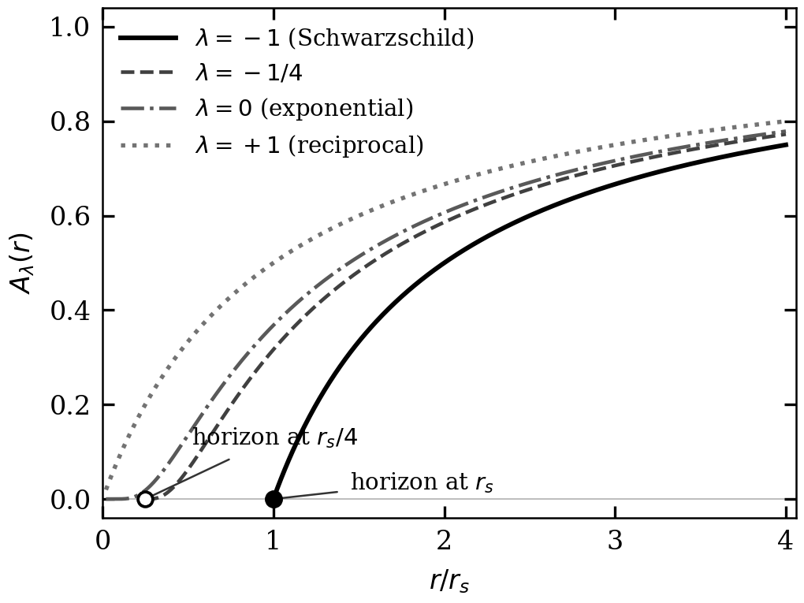

# 2. The ingredients, made explicit, and the family they leave behind

Every simple derivation of the Schwarzschild metric draws on some
subset of the same small stock of ingredients. We state them here in a
form strong enough to cover the published attempts, and then show
exactly how far they go.

We consider a static, spherically symmetric spacetime in areal
coordinates,

$$ds^2 = -A(r)\,c^2 dt^2 + B(r)\,dr^2 + r^2 d\Omega^2 ,$$

with $A, B \to 1$ as $r \to \infty$. The ingredients are:

**(I1) The Newtonian anchor.** In the weak field, clocks and orbits
reproduce Newtonian gravity with potential $\Phi = -GM/r$; in
particular $A = 1 + 2\Phi/c^2 + O(\Phi^2/c^4)$. This fixes the length
scale $r_s \equiv 2GM/c^2$ that appears in everything below. We write
$x \equiv r_s/r$.

**(I2) The bookkeeping assumption.** There exists a potential variable
$V$, some monotonic function of $A$, whose flux integral counts the
enclosed source exactly: $4\pi r^2 V'(r)$ is constant in vacuum, i.e.

$$\Delta V \equiv \frac{1}{r^2}\big(r^2 V'\big)' = 0
\qquad \text{(vacuum)} .$$

This is the shared engine of every energy-accounting argument: sources
add, the field has no preferred direction, and the strength of the
field through a closed surface is determined by what the surface
encloses. At first order (I1) forces $V = 1 + 2\Phi/c^2 + \dots$,
whatever $V$ is.

**(I3) Time–radial compensation.** $A(r)\,B(r) = 1$. This relation
holds for the Schwarzschild exterior and is assumed, or obtained from
auxiliary arguments about radial rulers, in the derivations we are
examining; Kassner (2015) discusses its standing in detail, and
Jacobson (2007) gives the general condition under which it holds. We
take it
as given for the entire analysis, for a reason that matters to the
logic of this paper: since every metric considered below satisfies it,
it can do no work in selecting among them.

**(I4) A constant counting weight.** The freedom left by (I2) is the
choice of variable: is the exact Gauss law obeyed by $A$ itself, by
$\ln A$, by $1/A$, or by some other function of $A$? We restrict this
freedom by one requirement: the weight with which the field's own
energy enters the books (made precise in a moment) is a constant of
the theory, not a function of field strength. A theory in which the
gravitating weight of field energy varied with the local field would
be a stranger theory than any in the literature we engage. One point
of candor: unlike (I1)–(I3), this ingredient is not articulated
anywhere in the historical derivations — it is this paper's
reconstruction of what they tacitly share, and it is load-bearing:
the completeness of the family below is completeness *relative to*
(I4). A derivation that restricted the variable freedom differently
would land outside the family; the reconstruction earns its keep in
Secs. 6 and 7, where every published route we examine turns out
either to live inside it or to add a selector of a different,
dynamics-grade kind.

## 2.1 The choice of variable is a self-sourcing weight

Write $s \equiv \ln A$, so that on the branch (I3) the metric is
determined by the single function $s(r)$. For any constant $\mu$ the
identity

$$\Delta\!\left(e^{\mu s}\right)
= \mu\, e^{\mu s}\Big[\Delta s + \mu\,(s')^2\Big]$$

holds, so the exact Gauss law in the variable $V = e^{\mu s}$ is
equivalent to

$$\Delta s = \lambda\,(s')^2 , \qquad \lambda \equiv -\mu .$$

The choice of bookkeeping variable is therefore not an innocent matter
of notation. In the fixed variable $s$ it appears as a nonlinear
source term with a definite coefficient: the field gradient feeds back
into its own equation with weight $\lambda$. Conversely, a general
monotonic variable $V = f(A)$ yields a coefficient that depends on
$s$; ingredient (I4) excludes exactly this, and restricts the choice
to the one-parameter family above. The parameter $\lambda$ is the
counting weight of ingredient (I4): $\lambda = 0$ counts no
self-sourcing at all (the Gauss law is exact in $\ln A$), and the sign
of $\lambda$ is the sign with which the field's gradient energy enters
its own books.

## 2.2 The family, exactly

The vacuum equation $\Delta s = \lambda (s')^2$ integrates in closed
form. With $u = s'$ it is a Bernoulli equation, $u' + 2u/r = \lambda
u^2$; the substitution $v = 1/u$ gives $v' - 2v/r = -\lambda$, hence
$v = r^2/r_s + \lambda r$ after the Newtonian anchor fixes the
integration constant. Integrating once more and imposing flatness at
infinity,

$$s(r) = -\frac{1}{\lambda}\ln\!\big(1 + \lambda x\big),
\qquad
A_\lambda(r) = \big(1 + \lambda x\big)^{-1/\lambda},
\qquad
B_\lambda = A_\lambda^{-1}.$$

Three members deserve names:

| $\lambda$ | $A(r)$ | character |
|---|---|---|
| $-1$ | $1 - x$ | Schwarzschild |
| $\;\;0$ | $e^{-x}$ | exponential (no self-sourcing) |
| $+1$ | $(1+x)^{-1}$ | reciprocal |

The closed form has appeared in the literature: Shuler (2018)
proposed, and Kassner (2019) subsequently pared back, exactly this
expression — in the parametrization
$g_{tt} = -(1 + n\,GM/rc^2)^{-2/n}$, $n = 2\lambda$ — as a set of
three members ($n = -2, -1, +1$, i.e.
$\lambda = -1, -1/2, +1/2$) assembled from assorted postulates. The
derivation above differs in what it establishes about the expression:
the continuum $A_\lambda$ is the *complete* residue of ingredients
(I1)–(I4) under a single principle, so the family is not a list of
proposals but a measurement of exactly how far the ingredients
underdetermine the exterior; and the index carries a physical meaning
— the counting weight — that the rest of the paper cashes out. The
distinction matters practically as well as rhetorically: both sides
of the Shuler–Kassner exchange treated the members as distinguishable
only by strong-field observations, a premise Sec. 5 will show fails
by a wide margin.

Expanding in $x$,

$$A_\lambda = 1 - x + \frac{1+\lambda}{2}\,x^2 + O(x^3):$$

the first-order coefficient is the same for every member, as (I1)
demands, and the members differ first at second order, where the
coefficient is a linear function of the counting weight. The
Schwarzschild member is the one whose areal expansion terminates.

Two consequences are immediate and worth stating now, ahead of the
quantitative treatment in Sec. 5. First, gravitational redshift
experiments compare clock rates at first order in $x$ and cannot
distinguish the members. Second, because the whole family shares the
spatial sector (I3), light bending and radar delay — which measure the
parametrized post-Newtonian (PPN) parameter $\gamma$ — cannot
distinguish them either; we confirm $\gamma = 1$ for every $\lambda$
in Sec. 5. Of the classical tests, only the perihelion precession
reaches the second-order coefficient where $\lambda$ lives. In PPN
terms the degeneracy should be stated carefully: the family fixes
$\gamma$ but leaves the nonlinearity parameter $\beta$ open, and
$\beta$ is itself a first post-Newtonian parameter — the fork lives
*inside* 1PN, in the one coefficient the $\gamma$-controlled tests do
not reach, not beyond it.

This is the precise sense in which the impossibility literature is
right. Ingredients (I1)–(I4) — the full strength of what Newtonian
limits, exact flux bookkeeping, and radial compensation provide — do
not determine the exterior. They determine it up to one number, and
that number multiplies exactly the term that distinguishes
Schwarzschild from rivals that match it at Newtonian order and in
$\gamma$.

*Figure 1. The family $A_\lambda(r)$ for
$\lambda \in \{-1, -1/4, 0, +1\}$. All members share the Newtonian
limit and differ first at second order. Members with $\lambda < 0$
terminate at horizons, $A = 0$ at $r = -\lambda r_s$ (filled dot:
Schwarzschild, at $r_s$; open dot: $\lambda = -1/4$, at $r_s/4$);
members with $\lambda \geq 0$ are positive for every $r > 0$ and have
no horizon (Sec. 3). Source:
`src_fig/figure_1_family.py`.*

The rest of the paper is about that number: what physically hangs on
it (Sec. 3), why no accounting argument fixes it (Sec. 4), which
measurement does (Sec. 5), and why the oldest shortcut in the subject
lands on the right member anyway (Sec. 6).
