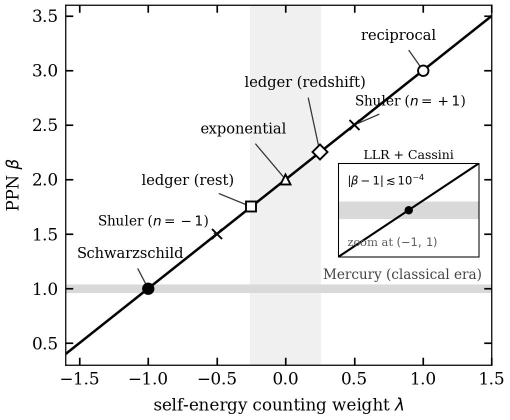

# 5. What β measures

The counting weight is not a hidden variable, and the question left
open by the last two sections — accounting cannot decide whether
horizons exist; what can? — has been answered by the solar system for
a century. The weight sits in the metric at second order. This section
computes where.

## 5.1 The family in PPN form

The PPN parameters are defined in isotropic coordinates, so we
transform. Writing $r = \rho\,(1 + k_1 w + k_2 w^2 + \dots)$ with
$w = r_s/\rho$ and requiring
$B(r)\,(dr/d\rho)^2 = r^2/\rho^2$ order by order gives

$$k_1 = \tfrac12, \qquad k_2 = \frac{1 - 4a_2}{16},$$

where $a_2 = (1+\lambda)/2$ is the family's second-order areal
coefficient from Sec. 2. The spatial metric becomes
$(r^2/\rho^2)\,(d\rho^2 + \rho^2 d\Omega^2)$ with
$r^2/\rho^2 = 1 + w + O(w^2)$, and comparison with the PPN form
$g_{ij} = (1 + 2\gamma\,U)\,\delta_{ij}$, $U = GM/c^2\rho = w/2$,
yields

$$\gamma = 1 \qquad \text{for every } \lambda .$$

The temporal component transforms to
$A = 1 - w + \left(a_2 + \tfrac12\right) w^2 + O(w^3)$, and comparison
with $-g_{00}/c^2 = 1 - 2U + 2\beta\,U^2$ gives
$\beta = 2 a_2 + 1$, that is,

$$\boxed{\;\beta - 1 = \lambda + 1\;}$$

exactly at this order. (The Schwarzschild member checks:
$\lambda = -1$ gives $a_2 = 0$, $k_2 = 1/16$ — the familiar isotropic
expansion — and $\beta = 1$.)

The dictionary is the point. In the standard formalism $\beta$ is
glossed as the degree of "nonlinearity in the superposition law for
gravity" (Will 2014); within this family the gloss becomes an
identity with a mechanism attached. The nonlinearity in question is
the self-sourcing weight of the field's gradient, and a measurement of
$\beta - 1$ is, term for term, a measurement of how the exterior
metric counts the field's contribution to its own source — offset by
one unit from the Schwarzschild counting.

## 5.2 The classical tests, sorted

The dictionary sorts the classical tests cleanly. Redshift experiments
sit at first order: blind to $\lambda$. Light deflection and radar
delay measure $\gamma$: blind to $\lambda$, since the whole family has
$\gamma = 1$ — every member predicts Eddington's $1.75''$ at the
solar limb. The perihelion precession is the exception. The standard
PPN expression scales the general-relativistic precession by
$\tfrac13(2 + 2\gamma - \beta)$, which for this family is

$$\frac{2 - \lambda}{3}.$$

Mercury's $43''$ per century thus discriminates where three of the
four classical tests cannot:

| $\lambda$ | $\beta$ | precession (″/century) | status |
|---|---|---|---|
| $-1$ (Schwarzschild) | $1$ | $43.0$ | observed |
| $-1/2$ (Shuler, $n=-1$) | $3/2$ | $35.8$ | excluded |
| $-1/4$ (ledger, rest convention) | $7/4$ | $32.3$ | excluded |
| $\;\;0$ (exponential) | $2$ | $28.7$ | excluded |
| $+1/4$ (ledger, redshift convention) | $9/4$ | $25.1$ | excluded |
| $+1/2$ (Shuler, $n=+1$) | $5/2$ | $21.5$ | excluded |
| $+1$ (reciprocal) | $3$ | $14.3$ | excluded |

The entire interval admitted by the accounting argument of Sec. 4
fails against data that predate the argument by a century. Even
the 1915-era precision on Mercury resolves $|\lambda + 1|$ at the few
percent level; the modern bound, $|\beta - 1| \lesssim 10^{-4}$ from
lunar laser ranging combined with the Cassini determination of
$\gamma$ (Will 2014), pins

$$\lambda = -1 \pm O(10^{-4}).$$

The same row of the table settles the Shuler–Kassner exchange on
terms neither side used. Shuler (2018) presented his members as
"differing only in strong fields" and proposed strong-field
experiments to tell them apart; Kassner (2019), reducing the family
theoretically, likewise took the members to behave identically in the
weak field, and offered black-hole ringdown observations as the
empirical discriminator against the horizonless $n = +1$ member. But
Shuler's non-Schwarzschild members sit at $\lambda = -1/2$ and
$\lambda = +1/2$: $\beta = 3/2$ and $5/2$, perihelion precessions of
roughly $36''$ and $21''$ per century against Mercury's $43''$. Both
were excluded by classical-era data before either paper was written.
Within this ingredient class there is no "weak-field-degenerate,
strong-field-distinguishable" family to adjudicate: the members agree
at Newtonian order and in $\gamma$, and the solar system reaches the
coefficient where they differ.

The dictionary also closes the loop opened in Sec. 3. Within the
family, a horizon exists if and only if $\lambda < 0$, that is, if and
only if $\beta < 2$. The existence of black-hole horizons — the
paradigm strong-field statement — is thereby equivalent to a
weak-field inequality, and the measured $\beta$ settles it five orders
of magnitude away from the boundary, using solar-system data and no
strong-field input at all. The statement is conditional on the family,
as any such statement must be; outside it, $\beta$ and horizon
structure decouple. But within the ingredient class examined here,
"do horizons exist?" is a question Mercury answered.

## 5.3 Relation to existing readings of β

Two connections should be drawn precisely, because each is close
enough to invite conflation.

First, Kassner (2015), reconstructing the Schwarzschild metric from
augmented postulates, reached the same structural situation from the
other direction: a second-order coefficient his assumptions could not
fix, which he determined from the perihelion data. The present
dictionary agrees with that procedure and adds the missing
interpretation — the undetermined coefficient is not an accident of
one derivation but the self-energy counting weight common to the whole
ingredient class, and the experiment that fixes it is measuring
something definite.

Second, the Nordtvedt effect. Lunar laser ranging constrains
$\eta = 4\beta - \gamma - 3$ by testing whether the Earth's
gravitational binding energy *falls* like other energy — self-energy
on the response side. The quantity organized by $\lambda$ is
self-energy on the *source* side: the weight with which field energy
generates field. In general relativity both readings are fixed
together, and the two are entangled in the PPN identities; but they
are logically distinct questions, and the family separates them
cleanly — every member has the same equivalence-principle kinematics,
while only $\lambda = -1$ sources like general relativity. Conflating
the two sides would overstate what either experiment shows.

*Figure 2. The dictionary $\beta = \lambda + 2$. The shaded vertical
strip is the full static-accounting interval; squares mark its two
operational audits, and crosses mark Shuler's two non-Schwarzschild
members. The horizontal gray band is the classical-era Mercury
constraint on $\beta$, drawn to scale; the accounting interval and
both Shuler members fall far outside it. The modern bound is four
orders of magnitude tighter and invisible
at this scale — the inset zooms to $|\lambda + 1| \le 6\times10^{-4}$
around the Schwarzschild point, where the LLR + Cassini band
$|\beta - 1| \lesssim 10^{-4}$ becomes visible. Source:
`src_fig/figure_2_beta_dictionary.py`.*
