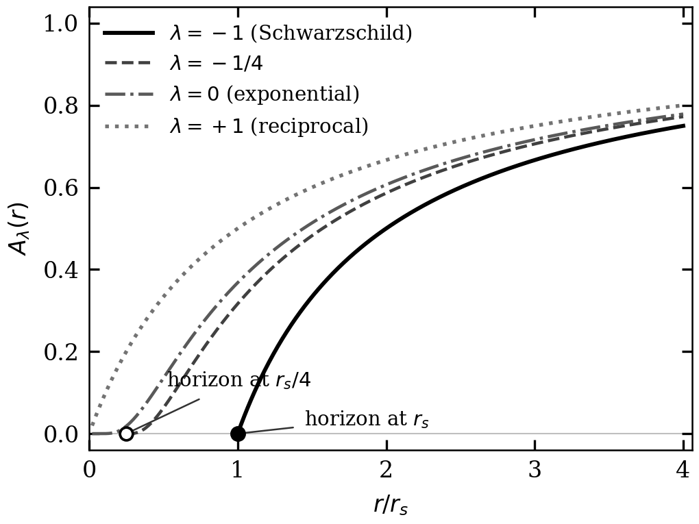

# 2. Explicit assumptions and the family they determine

The simple derivations considered in this paper use different combinations of a small number of recurring assumptions. To determine what these assumptions can establish, we formulate them in a common language and solve the resulting problem without imposing any additional dynamical condition.

We consider a static, spherically symmetric exterior written in areal coordinates,

[
ds^2
====

-A(r)c^2dt^2
+
B(r)dr^2
+
r^2d\Omega^2,
]

where

[
d\Omega^2=d\theta^2+\sin^2\theta,d\phi^2.
]

The coordinate (r) is the areal radius: a sphere at fixed (r) has area (4\pi r^2). We restrict attention initially to a static branch on which (A(r)>0), and we impose asymptotic flatness,

[
A(r)\to1,
\qquad
B(r)\to1,
\qquad
r\to\infty.
]

The derivation rests on four ingredients.

## 2.1 Assumptions

### (I1) Newtonian anchor

In the weak-field regime, clocks and orbits must reproduce Newtonian gravity with potential

[
\Phi(r)=-\frac{GM}{r}.
]

The time component of the metric therefore satisfies

[
A(r)
====

1+\frac{2\Phi}{c^2}
+
O!\left(\frac{\Phi^2}{c^4}\right)
=================================

1-\frac{2GM}{rc^2}
+
O(r^{-2}).
]

We define

[
r_s\equiv\frac{2GM}{c^2},
\qquad
x\equiv\frac{r_s}{r},
]

so that

[
A(r)=1-x+O(x^2).
]

This assumption fixes both the mass scale (r_s) and the leading weak-field behavior. It does not determine the nonlinear terms in (A(r)).

### (I2) Exact flux law in a potential variable

We assume that there exists a monotonic function (V(A)) whose radial gradient obeys an exact Gauss-type law in the vacuum exterior:

[
\Delta V
\equiv
\frac{1}{r^2}\frac{d}{dr}
\left(
r^2\frac{dV}{dr}
\right)
=0.
]

Equivalently,

[
4\pi r^2V'(r)=\text{constant}.
]

The factor (4\pi r^2) is the area of a sphere of areal radius (r). Thus (V'(r)) is the radial field strength associated with the chosen potential variable, while (4\pi r^2V'(r)) is its total flux through the sphere.

The flux is constant because every sphere in the vacuum exterior encloses the same total source under the assumed bookkeeping law. The local field strength is not constant; rather,

[
V'(r)\propto\frac{1}{r^2}.
]

Integration gives

[
V(r)=V_\infty-\frac{K}{r}.
]

Assumption (I1) fixes the weak-field normalization. We choose (V) so that

[
V(r)
====

1+\frac{2\Phi}{c^2}
+\cdots
=======

1-\frac{r_s}{r}
+\cdots.
]

The central freedom is that the flux law does not specify which function of the metric coefficient (A) should play the role of (V). An exact flux law for (A), for (\ln A), and for (1/A) produces different nonlinear metrics even though all choices agree at Newtonian order after normalization.

This flux law is an assumption of the bookkeeping construction; it is not asserted here as a general consequence of the Einstein equations.

### (I3) Time–radial compensation

We impose

[
A(r)B(r)=1.
]

Equivalently,

[
g_{tt}g_{rr}=-1
]

in the coordinates used here. The radial metric coefficient is therefore fixed once (A(r)) is known:

[
B(r)=\frac{1}{A(r)}.
]

This relation holds for the Schwarzschild exterior and appears either as an assumption or as the result of an auxiliary argument in the simple derivations under consideration. Kassner (2015) discusses its status in detail, and Jacobson (2007) gives a general condition under which it holds.

The condition expresses a reciprocal relation between the time and radial coefficients. For a stationary clock,

[
d\tau=\sqrt{A(r)},dt,
]

whereas a radial proper-distance element at fixed time is

[
d\ell=\sqrt{B(r)},dr
=\frac{dr}{\sqrt{A(r)}}.
]

A reduction in the clock-rate factor is therefore accompanied by an inverse increase in the radial-distance factor.

The condition also fixes the time–radial contribution to the metric determinant. It does not imply that ordinary three-dimensional spatial volume is unchanged.

Most importantly for the logic of this paper, every member derived below satisfies (AB=1). The condition therefore reduces the number of unknown metric functions but cannot select one member of the family over another.

### (I4) Constant self-sourcing coefficient

Assumption (I2) leaves an unrestricted choice of the potential variable (V(A)). We reduce this freedom by requiring that, when the flux equation is rewritten in a fixed metric variable, the coefficient of the nonlinear squared-gradient term be a constant of the theory rather than a function of the local field strength.

This is the assumption that produces the one-parameter family below. It is not stated explicitly in the historical derivations; it is our reconstruction of the restriction they tacitly impose on the choice of bookkeeping variable.

The assumption does not require the nonlinear coefficient to be nonzero. It permits

[
\lambda=0,
]

corresponding to no squared-gradient self-sourcing in the chosen metric variable. It requires only that

[
\lambda=\text{constant},
]

rather than (\lambda=\lambda(A)).

The completeness result below is therefore relative to assumptions (I1)–(I4), not a classification of all possible static, spherically symmetric metrics.

## 2.2 From variable choice to self-sourcing

Define

[
s(r)\equiv\ln A(r).
]

This is a change of variable, not a new independent field. Since

[
A=e^s,
\qquad
B=e^{-s},
]

the complete time–radial metric is determined by (s(r)).

The variable (s) is particularly useful because it reduces to a dimensionless Newtonian potential in the weak field. When (A=1+\epsilon) with (|\epsilon|\ll1),

[
s=\ln A=\epsilon+O(\epsilon^2),
]

and hence

[
s
=

\frac{2\Phi}{c^2}
+\cdots
=======

-\frac{r_s}{r}
+\cdots.
]

Now consider the one-parameter class of normalized potential variables

[
V_\mu(A)
========

1+\frac{A^\mu-1}{\mu},
\qquad
\mu\neq0.
]

Because (A=e^s),

[
V_\mu
=====

1+\frac{e^{\mu s}-1}{\mu}.
]

For every fixed (\mu), the weak-field expansion is

[
V_\mu
=====

# 1+s+O(s^2)

1+\frac{2\Phi}{c^2}
+\cdots,
]

so all members have the same Newtonian normalization.

Adding a constant or multiplying a potential by a nonzero constant does not change the vacuum equation (\Delta V=0). Therefore the exact flux law for (V_\mu) is equivalent, for (\mu\neq0), to

[
\Delta(e^{\mu s})=0.
]

In spherical symmetry,

[
\Delta s=s''+\frac{2}{r}s'.
]

Applying the chain and product rules gives the identity

[
\Delta(e^{\mu s})
=================

\mu e^{\mu s}
\left[
\Delta s+\mu(s')^2
\right].
]

On a branch where (e^{\mu s}\neq0), the vacuum flux equation is therefore equivalent to

[
\Delta s+\mu(s')^2=0.
]

Defining

[
\lambda\equiv-\mu,
]

we obtain

[
\boxed{
\Delta s=\lambda(s')^2
}.
]

The left-hand side contains the ordinary spherical Laplacian,

[
\Delta s=s''+\frac{2}{r}s',
]

while the right-hand side is nonlinear in the field gradient. The paper interprets

[
\lambda(s')^2
]

as the contribution of the field gradient to its own source, with (\lambda) giving the constant self-sourcing weight.

At this stage, however, the distinction between mathematics and interpretation should be kept explicit. The differential identity establishes the nonlinear term and its coefficient. Interpreting ((s')^2) as a gravitational energy density requires the additional accounting analysis of Sec. 4.

The value

[
\lambda=0
]

must be treated as the continuous limit (\mu\to0). Since

[
\lim_{\mu\to0}
\frac{A^\mu-1}{\mu}
===================

\ln A,
]

the normalized potential becomes

[
V_0=1+\ln A=1+s.
]

Its exact flux equation is simply

[
\Delta s=0.
]

Thus (\lambda=0) is the member for which the logarithmic metric variable obeys the linear Gauss law exactly.

## 2.3 Why a constant coefficient gives a complete one-parameter class

The preceding construction used an exponential function of (s). We now show that the constant-coefficient assumption permits no essentially different choice.

Let the bookkeeping variable be an arbitrary monotonic function

[
V=F(s),
]

with

[
F'(s)\neq0
]

on the branch of interest. The chain rule gives

[
\Delta V
========

F'(s)\Delta s
+
F''(s)(s')^2.
]

Imposing

[
\Delta V=0
]

and dividing by (F'(s)) yields

[
\Delta s
========

-\frac{F''(s)}{F'(s)}(s')^2.
]

The effective self-sourcing coefficient is therefore

[
\lambda(s)
==========

-\frac{F''(s)}{F'(s)}.
]

For a general function (F), this coefficient depends on (s) and therefore on the local field strength. Assumption (I4) requires

[
-\frac{F''(s)}{F'(s)}=\lambda,
]

where (\lambda) is constant. Hence

[
F''(s)=-\lambda F'(s).
]

For (\lambda\neq0), the solution is

[
F(s)=C_0+C_1e^{-\lambda s}.
]

Since (A=e^s),

[
F(s)=C_0+C_1A^{-\lambda}.
]

The constants (C_0) and (C_1\neq0) amount only to an additive shift and multiplicative normalization of the potential and do not alter the vacuum equation. The essential variable is therefore

[
V\propto A^{-\lambda}.
]

For (\lambda=0),

[
F''(s)=0,
]

so

[
F(s)=C_0+C_1s,
]

and the essential variable is

[
V\propto\ln A.
]

Thus the power-law variables, together with the logarithmic limiting case, form the complete class allowed by assumptions (I2) and (I4). This is the precise sense in which the family derived below is complete relative to the stated assumptions.

## 2.4 Exact integration

The vacuum equation is

[
s''+\frac{2}{r}s'
=================

\lambda(s')^2.
]

Set

[
u(r)\equiv s'(r).
]

Then

[
u'+\frac{2}{r}u=\lambda u^2.
]

This is a Bernoulli equation. Introducing

[
v(r)\equiv\frac{1}{u(r)}
]

gives

[
v'=-\frac{u'}{u^2}.
]

Dividing the equation for (u) by (u^2) and substituting (v=1/u) yields

[
v'-\frac{2}{r}v=-\lambda.
]

Multiplying by the integrating factor (r^{-2}),

[
\left(\frac{v}{r^2}\right)'
===========================

-\frac{\lambda}{r^2}.
]

Integration gives

[
v(r)=Cr^2+\lambda r.
]

The Newtonian anchor determines (C). Far from the source,

[
s(r)\sim-\frac{r_s}{r},
\qquad
s'(r)\sim\frac{r_s}{r^2}.
]

Since (v=1/s'),

[
v(r)\sim\frac{r^2}{r_s},
]

and therefore

[
C=\frac{1}{r_s}.
]

Thus

[
v(r)
====

\frac{r^2}{r_s}
+
\lambda r,
]

and

[
s'(r)
=====

# \frac{1}{v(r)}

\frac{r_s}{r(r+\lambda r_s)}.
]

For (\lambda\neq0), partial fractions give

[
s'
==

\frac{1}{\lambda}
\left[
\frac{1}{r}
-----------

\frac{1}{r+\lambda r_s}
\right].
]

Integrating,

[
s(r)
====

\frac{1}{\lambda}
\left[
\ln r-\ln(r+\lambda r_s)
\right]
+C_0.
]

Asymptotic flatness requires

[
A\to1
\quad\Longleftrightarrow\quad
s\to0
]

as (r\to\infty), so (C_0=0). Therefore,

[
s(r)
====

-\frac{1}{\lambda}
\ln\left(
1+\lambda\frac{r_s}{r}
\right).
]

Exponentiating,

[
\boxed{
A_\lambda(r)
============

\left(
1+\lambda\frac{r_s}{r}
\right)^{-1/\lambda}
},
]

with

[
\boxed{
B_\lambda(r)=A_\lambda(r)^{-1}
}.
]

For (\lambda=0), the field equation is

[
\Delta s=0.
]

The Newtonian and asymptotic conditions give

[
s(r)=-\frac{r_s}{r},
]

and hence

[
A_0(r)=e^{-r_s/r}.
]

This result is also the continuous limit of the general expression:

[
\lim_{\lambda\to0}
\left(
1+\lambda\frac{r_s}{r}
\right)^{-1/\lambda}
====================

e^{-r_s/r}.
]

## 2.5 Distinguished members

Three members provide useful reference points:

| (\lambda) | Exact-flux variable | (A_\lambda(r))   | Description   |
| --------: | ------------------- | ---------------- | ------------- |
|      (-1) | (A)                 | (1-r_s/r)        | Schwarzschild |
|       (0) | (\ln A)             | (e^{-r_s/r})     | exponential   |
|      (+1) | (1/A)               | ((1+r_s/r)^{-1}) | reciprocal    |

For

[
\lambda=-1,
]

the exact Gauss law is obeyed by (A) itself:

[
\Delta A=0.
]

The solution is

[
A_{-1}(r)=1-\frac{r_s}{r},
]

which gives the Schwarzschild exterior.

For

[
\lambda=0,
]

the exact Gauss law is obeyed by (s=\ln A):

[
\Delta(\ln A)=0,
]

giving

[
A_0(r)=e^{-r_s/r}.
]

For

[
\lambda=+1,
]

the exact Gauss law is obeyed by (1/A), giving

[
A_{+1}(r)=\frac{1}{1+r_s/r}.
]

The closed-form expression has appeared previously. Shuler (2018) proposed, and Kassner (2019) subsequently reduced, three members written as

[
g_{tt}
======

-\left(
1+n\frac{GM}{rc^2}
\right)^{-2/n},
]

with

[
n=2\lambda.
]

The values (n=-2,-1,+1) correspond to

[
\lambda=-1,-\frac12,+\frac12.
]

The present derivation differs in two respects. First, it derives the continuous family rather than listing selected candidates. Second, it shows that the family is the complete residual freedom under assumptions (I1)–(I4), with (\lambda) identified as the constant coefficient of the squared-gradient term in the (s=\ln A) equation.

The derivation does not select the Schwarzschild value. It establishes only that Schwarzschild is one member of the allowed family.

## 2.6 Weak-field degeneracy

Expanding the family in

[
x=\frac{r_s}{r},
]

we obtain

[
A_\lambda
=========

1-x+\frac{1+\lambda}{2}x^2+O(x^3).
]

The first-order term,

[
-x=-\frac{r_s}{r},
]

is independent of (\lambda), as required by the Newtonian anchor. The family members first differ at order (x^2), where the coefficient is

[
\frac{1+\lambda}{2}.
]

For the Schwarzschild member,

[
\lambda=-1,
]

this coefficient vanishes:

[
A_{-1}=1-x.
]

In areal coordinates, the Schwarzschild expansion terminates at first order. This termination is a coordinate-dependent statement; the invariant content is that the members differ in their nonlinear post-Newtonian behavior.

The weak-field degeneracy has immediate observational consequences. Experiments sensitive only to the leading gravitational redshift cannot determine (\lambda), because every member has

[
A_\lambda=1-x+O(x^2).
]

Likewise, assumption (I3) enforces a common first-order relation between the time and radial metric coefficients. As shown explicitly after transformation to isotropic coordinates in Sec. 5, this gives

[
\gamma=1
]

for every member. Light bending and radar time delay, whose leading PPN dependence is controlled by (\gamma), therefore do not distinguish the family.

The remaining freedom appears in the nonlinear PPN parameter (\beta). Perihelion precession is sensitive to this coefficient and can therefore discriminate among metrics that agree in the Newtonian limit and in (\gamma).

The distinction should be stated carefully. The family does not first diverge beyond first post-Newtonian order. Rather, it agrees in the (\gamma)-controlled part of the 1PN metric while leaving the (\beta)-controlled nonlinear coefficient undetermined.

## 2.7 Result

Assumptions (I1)–(I4) determine the static spherical exterior up to one dimensionless constant:

[
ds^2
====

*

\left(
1+\lambda\frac{r_s}{r}
\right)^{-1/\lambda}
c^2dt^2
+
\left(
1+\lambda\frac{r_s}{r}
\right)^{1/\lambda}
dr^2
+
r^2d\Omega^2,
]

with the continuous (\lambda=0) interpretation

[
A_0=e^{-r_s/r}.
]

The four assumptions play distinct roles:

[
\text{(I1) fixes }r_s\text{ and the leading weak-field term};
]

[
\text{(I2) supplies an exact }1/r\text{ flux structure};
]

[
\text{(I3) fixes }B\text{ once }A\text{ is known};
]

[
\text{(I4) reduces the variable freedom to one constant }\lambda.
]

They do not determine the value of (\lambda). In particular, they do not uniquely select

[
\lambda=-1.
]

This is the precise content of the underdetermination identified by the impossibility literature. The assumptions determine a one-parameter family containing Schwarzschild, not the Schwarzschild exterior alone.

The following sections examine what depends on the remaining parameter: Sec. 3 determines when the static time coefficient has a finite-radius zero, Sec. 4 asks what a specified static energy ledger can determine about (\lambda), Sec. 5 relates it to post-Newtonian observables, and Sec. 6 identifies the additional condition underlying Michell’s exact numerical result.

*Figure 1. The metric function (A_\lambda(r)) for (\lambda\in{-1,-1/4,0,+1}). All members share the Newtonian limit and first differ at quadratic order in (r_s/r). Negative-(\lambda) members reach (A_\lambda=0) at (r=-\lambda r_s); the Schwarzschild member terminates at (r=r_s), while the (\lambda=-1/4) member terminates at (r=r_s/4). Members with (\lambda\geq0) remain positive for every finite (r>0). Source: `src_fig/figure_1_family.py`.*
