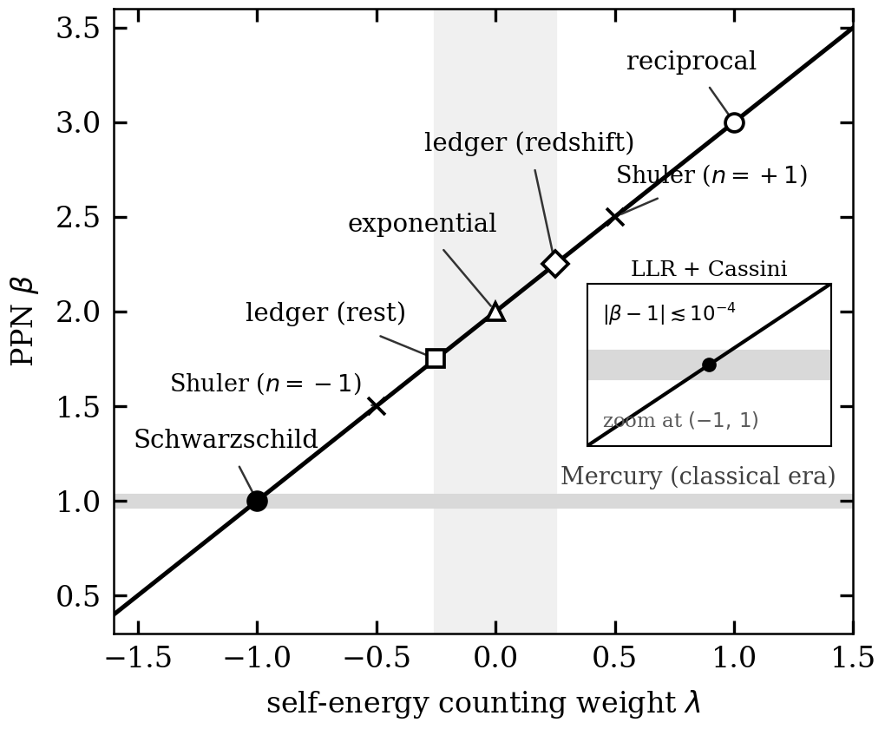

# 5. PPN identification of the parameter (\lambda)

Sections 2–4 leave one dimensionless parameter undetermined. The static assumptions supply a family of metrics,

[
A_\lambda(r)
============

\left(
1+\lambda\frac{r_s}{r}
\right)^{-1/\lambda},
]

but do not select the Schwarzschild value

[
\lambda=-1.
]

The parameter enters the weak-field metric at nonlinear order. Transforming the family from areal to isotropic coordinates gives

[
\gamma=1,
\qquad
\beta=\lambda+2.
]

This identifies (\lambda) independently of the local energy-density interpretation used in Sec. 4. Its application to particular PPN tests requires the test-specific assumptions stated below.

## 5.1 PPN form of the metric

The parametrized post-Newtonian formalism expresses a weak, slowly varying gravitational field in a standard coordinate form (Will 2014). For a static spherical source, the relevant isotropic-coordinate metric is

[
ds^2
====

-

\left(
1-2U+2\beta U^2+O(U^3)
\right)c^2dt^2
+
\left(
1+2\gamma U+O(U^2)
\right)
\left(
d\rho^2+\rho^2d\Omega^2
\right),
]

where

[
U\equiv\frac{GM}{c^2\rho}
]

is the dimensionless Newtonian potential.

The two PPN parameters used here have distinct roles:

[
\gamma
]

controls the leading spatial-curvature term, while

[
\beta
]

controls the first nonlinear correction to the temporal metric component.

General relativity predicts

[
\gamma=1,
\qquad
\beta=1.
]

The family of Sec. 2 is instead written in areal coordinates,

[
ds^2
====

-A(r)c^2dt^2
+
B(r)dr^2
+
r^2d\Omega^2,
\qquad
B=\frac1A.
]

To compare it with the PPN form, we introduce an isotropic radius (\rho).

### 5.1.1 Coordinate transformation

Write the areal-coordinate expansion as

[
A(r)
====

1-x+a_2x^2+O(x^3),
\qquad
x\equiv\frac{r_s}{r},
]

with

[
a_2=\frac{1+\lambda}{2}.
]

We seek a transformation of the form

[
r
=

\rho
\left(
1+k_1w+k_2w^2+O(w^3)
\right),
\qquad
w\equiv\frac{r_s}{\rho}.
]

The isotropic spatial metric must have the form

[
\Psi^2(\rho)
\left(
d\rho^2+\rho^2d\Omega^2
\right).
]

Because the angular coefficient is (r^2), the conformal factor is

[
\Psi^2(\rho)=\frac{r^2}{\rho^2}.
]

Matching the radial coefficient therefore requires

[
B(r)
\left(
\frac{dr}{d\rho}
\right)^2
=========

\frac{r^2}{\rho^2}.
]

Expanding this condition through second order gives

[
k_1=\frac12,
\qquad
k_2=\frac{1-4a_2}{16}.
]

The spatial conformal factor is consequently

[
\frac{r^2}{\rho^2}
==================

1+w+O(w^2).
]

Since

[
w
=
\frac{r_s}{\rho}
=
\frac{2GM}{c^2\rho}
=
2U,
]

the spatial metric becomes

[
g_{ij}
======

\left(
1+2U+O(U^2)
\right)\delta_{ij}.
]

Comparison with the PPN definition

[
g_{ij}
======

\left(
1+2\gamma U+O(U^2)
\right)\delta_{ij}
]

therefore gives

[
\boxed{
\gamma=1
}
]

for every value of (\lambda).

The family is degenerate in the leading spatial PPN coefficient.

### 5.1.2 Temporal component

The coordinate relation implies

[
x
=

w-\frac12w^2+O(w^3).
]

Substituting into

[
A=1-x+a_2x^2+O(x^3)
]

gives

[
A(\rho)
=======

1-w+
\left(
a_2+\frac12
\right)w^2
+
O(w^3).
]

Using (w=2U),

[
A(\rho)
=======

1-2U
+
4\left(
a_2+\frac12
\right)U^2
+
O(U^3).
]

The standard PPN temporal component is

[
A_{\rm PPN}
===========

1-2U+2\beta U^2+O(U^3).
]

Matching the quadratic terms yields

[
2\beta
======

4\left(
a_2+\frac12
\right),
]

and therefore

[
\beta=2a_2+1.
]

Since

[
a_2=\frac{1+\lambda}{2},
]

we obtain

[
\boxed{
\beta=\lambda+2
}
]

or equivalently

[
\boxed{
\beta-1=\lambda+1
}.
]

Thus

[
\boxed{
\lambda=\beta-2
}.
]

For the Schwarzschild member,

[
\lambda=-1,
]

and hence

[
a_2=0,
\qquad
\beta=1,
\qquad
\gamma=1,
]

as required.

The relation (\beta=\lambda+2) is exact as a relation between (\lambda) and the coefficient defined at first post-Newtonian order. It does not imply that the full metrics agree or differ only at that order.

## 5.2 Interpretation of the PPN relation

In the standard PPN terminology, (\beta) measures nonlinearity in the gravitational superposition law. Here that description becomes explicit: the same parameter that multiplies the nonlinear squared-gradient term in

[
\Delta s=\lambda(s')^2
]

also determines the coefficient of (U^2) in the isotropic temporal metric.

The relation is

[
\lambda=\beta-2.
]

A measurement of (\beta) determines which member of the family describes the exterior. This conclusion follows from the metric expansion and coordinate transformation, without choosing a local division between matter and field energy.

## 5.3 Which classical tests distinguish the family?

The classical solar-system tests probe different parts of the weak-field metric.

### Gravitational redshift

At leading order,

[
A_\lambda
=========

1-\frac{r_s}{r}
+
O\!\left(
\frac{r_s^2}{r^2}
\right)
]

for every (\lambda).

Leading gravitational-redshift measurements therefore test the common Newtonian term and do not distinguish the family members. More precise higher-order redshift measurements could, in principle, probe the nonlinear coefficient.

### Light deflection and radar time delay

At leading post-Newtonian order, light deflection and Shapiro radar delay depend primarily on the parameter (\gamma).

Because

[
\gamma=1
]

throughout the family, every member gives the same leading light-deflection and time-delay predictions as general relativity.

Higher-order propagation effects can depend on coefficients beyond (\gamma); the degeneracy applies only to the leading PPN tests.

### Perihelion precession

The perihelion advance of a test body depends on both (\gamma) and (\beta). In a fully conservative metric theory with the other relevant PPN parameters absent, the leading anomalous precession relative to the general-relativistic value is multiplied by

[
\frac{2+2\gamma-\beta}{3}.
]

For the present family,

[
\gamma=1,
\qquad
\beta=\lambda+2,
]

so the factor becomes

[
\boxed{
\frac{2-\lambda}{3}
}.
]

Mercury’s perihelion precession can therefore distinguish metrics that agree in the Newtonian limit and in (\gamma).

Using (43.0'') per century as the general-relativistic anomalous precession, the family predicts:

| (\lambda) | (\beta=\lambda+2) | PPN factor ((2-\lambda)/3) | Precession (({}''/{\rm century})) |
| --------: | ----------------: | -------------------------: | --------------------------------: |
|      (-1) |               (1) |                        (1) |                            (43.0) |
|    (-1/2) |             (3/2) |                      (5/6) |                            (35.8) |
|    (-1/4) |             (7/4) |                      (3/4) |                            (32.3) |
|       (0) |               (2) |                      (2/3) |                            (28.7) |
|    (+1/4) |             (9/4) |                     (7/12) |                            (25.1) |
|    (+1/2) |             (5/2) |                      (1/2) |                            (21.5) |
|      (+1) |               (3) |                      (1/3) |                            (14.3) |

Within the present one-parameter family and the stated conservative PPN assumptions, all listed non-Schwarzschild members are incompatible with the observed Mercury precession.

In particular, the complete static-accounting interval obtained in Sec. 4,

[
-\frac14\leq\lambda\leq\frac14,
]

corresponds to

[
\frac74\leq\beta\leq\frac94.
]

That interval predicts only approximately (25'')–(32'') per century, rather than the observed value near (43'').

The Shuler members

[
\lambda=-\frac12,
\qquad
\lambda=+\frac12
]

likewise correspond to

[
\beta=\frac32,
\qquad
\beta=\frac52,
]

and are distinguishable using weak-field orbital data. They are not degenerate with Schwarzschild throughout the post-Newtonian regime; they agree only at Newtonian order and in the leading (\gamma)-controlled effects.

## 5.4 Observational determination of (\lambda)

The PPN relation converts any bound on (\beta) directly into a bound on (\lambda):

[
\lambda+1=\beta-1.
]

Representative solar-system analyses constrain (\beta-1) at approximately the (10^{-4}) level or better. An LLR analysis combined with the Cassini constraint on (\gamma) found (Williams, Turyshev, and Boggs 2004)

[
\beta-1=(1.2\pm1.1)\times10^{-4},
]

while the INPOP20a planetary ephemeris analysis reported a conservative bound of approximately (Fienga et al. 2022)

[
|\beta-1|\lesssim7.2\times10^{-5}.
]

The LLR value combines a strong-equivalence-principle result with the Cassini determination of (\gamma), whereas the INPOP20a number is a conservative acceptance bound from alternative planetary ephemerides. The LLR inference also assumes the restricted PPN relation (\eta_N=4\beta-\gamma-3); the one-body exterior derived here does not determine the full many-body PPN sector. We use the quoted bounds only to establish the relevant order of magnitude.

At the order of magnitude relevant here, the result is

[
|\lambda+1|
\lesssim10^{-4}.
]

Thus

[
\boxed{
\lambda\simeq-1
}
]

and the Schwarzschild member is selected to high precision.

## 5.5 Finite-radius zeros and the condition (\beta<2)

Section 3 showed that

[
A_\lambda(r)
]

has a finite-radius zero if and only if

[
\lambda<0.
]

Using

[
\lambda=\beta-2,
]

this condition becomes

[
\boxed{
\beta<2
}.
]

The measured value

[
\beta\simeq1
]

lies far from the boundary (\beta=2) relative to current observational uncertainties.

Combining the PPN relation with Sec. 3, weak-field measurements of (\beta) determine whether (A_\lambda) has a finite-radius zero.

## 5.6 Relation to earlier metric reconstructions

Kassner’s 2015 reconstruction reached a structurally similar result from a different direction: the assumed postulates fixed the leading metric terms but left a nonlinear coefficient that had to be supplied by perihelion data.

The present family places that residual coefficient in a continuous classification. The undetermined quantity is

[
\lambda,
]

and the PPN transformation shows that

[
\lambda=\beta-2.
]

The observational input therefore selects a definite member of the metric family.

Kassner’s 2019 analysis selects among Shuler’s proposed metrics by imposing a standard relativistic generalization of Newton’s law. The present classification gives the family before that condition is imposed.

The metric relation does not identify a unique, convention-independent local gravitational energy density. The self-energy interpretation of (\lambda) depends on the additional accounting choices in Sec. 4.

*Figure 2. The relation (\beta=\lambda+2). The shaded vertical strip represents the conditional interval (-1/4\leq\lambda\leq1/4); its endpoints correspond to the two matter-energy conventions in Sec. 4. The non-Schwarzschild Shuler members occur at (\lambda=-1/2) and (\lambda=+1/2). All lie far from the observationally selected region near (\lambda=-1). The inset shows the order-of-magnitude LLR+Cassini constraint (|\beta-1|\lesssim10^{-4}) reported by Williams, Turyshev, and Boggs (2004); it is illustrative rather than a new confidence interval. Source: `src_fig/figure_2_beta_dictionary.py`.*
