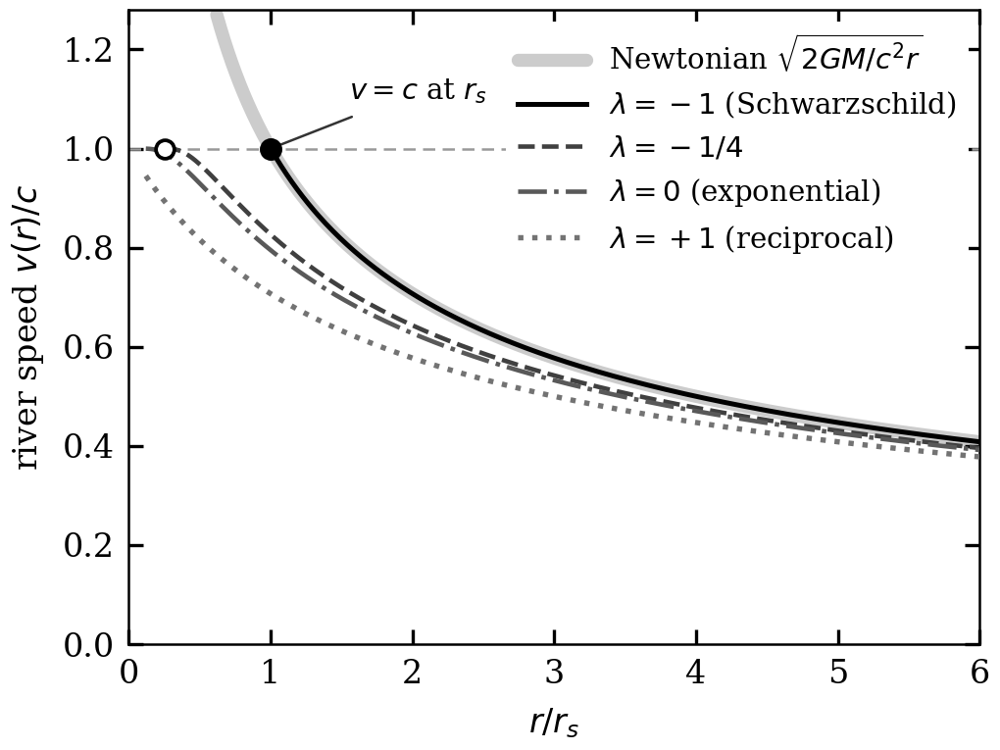

# 6. The Michell coincidence

In 1784, Michell combined the Newtonian escape relation

[
\frac12v^2=\frac{GM}{r}
]

with the condition (v=c) and obtained

[
r=\frac{2GM}{c^2}=r_s.
]

Laplace later gave the same argument. The numerical result is the Schwarzschild radius, although the calculation predates general relativity by more than a century and applies Newtonian mechanics outside its domain of validity. The nonrelativistic kinetic-energy formula is not valid at (v=c), and Newtonian gravity supplies neither a spacetime metric nor a causal horizon.

The usual conclusion—that Michell did not derive the Schwarzschild geometry—is correct. It does not, however, explain why the calculation produces the exact relativistic radius rather than merely the correct dimensional scale.

The family derived in Sec. 2 provides such an explanation. Every member can be written, on its static exterior, in a Painlevé–Gullstrand-type form. The Schwarzschild member is uniquely characterized by the fact that the resulting radial shift profile is exactly Newtonian at every radius.

Throughout this section, the Painlevé–Gullstrand construction is understood on the branch (A>0). For Schwarzschild, the coordinates extend regularly through (A=0).

## 6.1 Painlevé–Gullstrand form of the family

Begin with

[
ds^2
====

-A(r)c^2dt^2
+
\frac{dr^2}{A(r)}
+
r^2d\Omega^2.
]

Introduce a new time coordinate (T) through

[
dt
==

## dT

\frac{\sqrt{1-A(r)}}{cA(r)},dr.
]

Substitution gives

[
ds^2
====

-c^2dT^2
+
\left[
dr+v(r)dT
\right]^2
+
r^2d\Omega^2,
]

where

[
\boxed{
v(r)=c\sqrt{1-A(r)}
}.
]

Expanding the square,

[
ds^2
====

-\left(c^2-v^2\right)dT^2
+
2v,dr,dT
+
dr^2
+
r^2d\Omega^2.
]

The spatial geometry on a surface of constant (T) is

[
d\ell^2
=======

dr^2+r^2d\Omega^2,
]

the metric of flat Euclidean space in spherical coordinates. The gravitational geometry has not disappeared. It is encoded partly in the mixed term

[
2v,dr,dT,
]

which couples radial position to time and tilts the radial light cones.

The function (v(r)) is often described as a river velocity. This is a useful representation of the coordinate shift, not the velocity of a material substance.

For the family

[
A_\lambda(r)
============

\left(
1+\lambda\frac{r_s}{r}
\right)^{-1/\lambda},
]

the corresponding profile is

[
\boxed{
v_\lambda(r)
============

c\sqrt{
1-
\left(
1+\lambda\frac{r_s}{r}
\right)^{-1/\lambda}
}
}.
]

All members therefore admit the same flat-slice form; they differ in the radial profile (v_\lambda(r)).

## 6.2 The unique Newtonian profile

The Newtonian speed of a particle falling from rest at infinity satisfies

[
\frac12v_{\rm N}^2=\frac{GM}{r}.
]

Using

[
r_s=\frac{2GM}{c^2},
]

this may be written as

[
\frac{v_{\rm N}^2}{c^2}
=======================

\frac{r_s}{r}.
]

The Painlevé–Gullstrand relation gives

[
\frac{v_\lambda^2}{c^2}
=======================

1-A_\lambda(r).
]

Exact agreement with the Newtonian profile at every radius therefore requires

[
1-A_\lambda(r)
==============

\frac{r_s}{r}.
]

Equivalently,

[
A_\lambda(r)
============

1-\frac{r_s}{r}.
]

This is precisely the member

[
\boxed{
\lambda=-1
}.
]

Thus

[
\boxed{
v_{-1}(r)
=========

\sqrt{\frac{2GM}{r}}
}
]

holds exactly throughout the Schwarzschild exterior.

The uniqueness can also be seen from the weak-field expansion:

[
1-A_\lambda
===========

x-\frac{1+\lambda}{2}x^2+O(x^3),
\qquad
x=\frac{r_s}{r}.
]

Every member reproduces the Newtonian profile at leading order,

[
\frac{v_\lambda^2}{c^2}=x+O(x^2),
]

but the quadratic correction vanishes only when

[
1+\lambda=0.
]

This is a dynamical or slicing condition stronger than the Newtonian limit. The Newtonian anchor requires agreement only when (r_s/r\ll1); the condition above imposes the Newtonian velocity law at every radius.

## 6.3 Radial light propagation

The Painlevé–Gullstrand metric makes the causal significance of the profile transparent.

For radial light,

[
ds^2=0,
\qquad
d\Omega=0.
]

Therefore,

[
0
=

-c^2dT^2
+
\left(
dr+v,dT
\right)^2.
]

Taking the two square-root branches gives

[
dr+v,dT=\pm c,dT,
]

and hence

[
\boxed{
\frac{dr}{dT}=-v\pm c
}.
]

The outward and inward radial coordinate velocities are

[
\left(
\frac{dr}{dT}
\right)_{\rm out}
=================

c-v,
]

and

[
\left(
\frac{dr}{dT}
\right)_{\rm in}
================

-c-v.
]

At a surface where

[
v=c,
]

outward-directed light satisfies

[
\left(
\frac{dr}{dT}
\right)_{\rm out}=0.
]

For (v>c), even the outward branch has

[
\frac{dr}{dT}<0.
]

This causal behavior is not Newtonian. It follows from the mixed space–time term in the relativistic metric. The velocity profile may have a Newtonian form, but the geometry in which it appears does not.

For the Schwarzschild member,

[
v^2=\frac{2GM}{r}.
]

The condition (v=c) therefore gives

[
c^2=\frac{2GM}{r},
]

or

[
\boxed{
r=r_s
}.
]

The same equation used by Michell consequently identifies the Schwarzschild horizon radius when interpreted through the independently selected Schwarzschild geometry.

## 6.4 What Michell’s calculation did and did not establish

Michell’s calculation did not derive the Schwarzschild metric. It supplied neither the radial metric component nor the mixed space–time structure that appears in Painlevé–Gullstrand coordinates. It did not establish the causal behavior of light at (r_s), and its Newtonian premises could not select the Schwarzschild member from the family.

The valid logical direction is

[
\text{dynamics or observation}
\longrightarrow
\lambda=-1,
]

followed by

[
\lambda=-1
\longrightarrow
v^2=\frac{2GM}{r}
\quad\text{in Painlevé--Gullstrand form},
]

and therefore

[
v=c
\longrightarrow
r=r_s.
]

The exact agreement is nevertheless more structured than a dimensional coincidence. Michell used a velocity relation that later turns out to be exact for freely falling frames in a particular slicing of the Schwarzschild spacetime. What was accidental was the applicability of that relation to the physically selected member.

A concise statement of the resolution is therefore:

> Michell’s Newtonian calculation reproduces the exact Schwarzschild radius because the Schwarzschild exterior, uniquely within the family, admits a Painlevé–Gullstrand representation whose radial shift profile obeys the Newtonian infall law exactly.

## 6.5 Why the shortcut is incomplete

If one supplements the Newtonian potential with an independently flat static spatial metric,

[
ds^2
====

*

\left(
1-\frac{r_s}{r}
\right)c^2dt^2
+
dr^2+r^2d\Omega^2,
]

then the resulting model has

[
\gamma=0
]

rather than the observed value

[
\gamma=1.
]

At leading order, it predicts only half the general-relativistic deflection of light.

The failure does not arise because the numerical radius is wrong. It arises because the time coefficient alone is insufficient. The radial and angular geometry, or equivalently the full space–time metric, carries essential physical information.

Painlevé–Gullstrand coordinates make this distinction especially clear. Their constant-(T) spatial slices are flat, but the full spacetime is not described by a static flat-space ansatz because it contains the mixed term

[
2v,dr,dT.
]

The Newtonian-looking profile becomes physically meaningful only as one component of the complete relativistic metric.

## 6.6 Implications for simple derivations

The family clarifies the longstanding disagreement between impossibility and possibility arguments.

The base ingredients considered in Sec. 2 determine

[
A_\lambda(r)
]

but leave (\lambda) free. They therefore do not determine the Schwarzschild metric uniquely.

Derivations that reach Schwarzschild introduce an additional member-selecting condition. The selector may take several forms:

* an exact Newtonian infall profile in flat spatial slices;
* an exact inverse-square force law extended beyond the Newtonian limit;
* a curvature or field-equation condition;
* a condition on the evolution of freely falling matter;
* an observational value of the nonlinear PPN coefficient (\beta).

These conditions are not equivalent in their physical motivation, but they perform the same logical task in the classification: they select

[
\lambda=-1.
]

Visser’s Painlevé–Gullstrand construction imposes the Newtonian infall profile within a flat-slice geometry. In the present classification, that profile is equivalent to selecting the Schwarzschild member.

Czerniawski follows a closely related route. Kassner introduces additional postulates beyond the common weak-field ingredients and uses perihelion data when a nonlinear coefficient remains free. Shuler’s proposed alternatives are members of the same family, while Kassner’s later dust-ball condition supplies a dynamical criterion that reduces the set.

The apparent conflict between the historical positions can therefore be restated more precisely:

> The common accounting assumptions determine a family rather than a unique exterior. Successful simple derivations reach Schwarzschild because they add a condition that selects one member of that family.

The impossibility result concerns derivation from the base ingredients alone. The possibility constructions succeed with stronger assumptions. The family identifies the exact freedom that those additional assumptions remove.

## 6.7 Result

For every member of the static family, the metric can be written on its exterior branch as

[
ds^2
====

-c^2dT^2
+
\left(
dr+v_\lambda(r)dT
\right)^2
+
r^2d\Omega^2,
]

with

[
v_\lambda(r)
============

c\sqrt{1-A_\lambda(r)}.
]

The exact Newtonian relation

[
\frac12v_\lambda^2=\frac{GM}{r}
]

holds at every radius if and only if

[
\lambda=-1.
]

The Schwarzschild member is therefore uniquely Newtonian-looking in this Painlevé–Gullstrand sense.

This result explains the exact coefficient in Michell’s calculation after the Schwarzschild member has been selected independently.

*Figure 3. Painlevé–Gullstrand profiles (v_\lambda(r)/c=\sqrt{1-A_\lambda(r)}), compared with the Newtonian infall profile (\sqrt{r_s/r}). The Schwarzschild member (\lambda=-1) coincides with the Newtonian curve at every radius. All other members agree at leading order for (r\gg r_s) and depart at nonlinear order. Source: `src_fig/figure_3_river_ledger.py`.*
