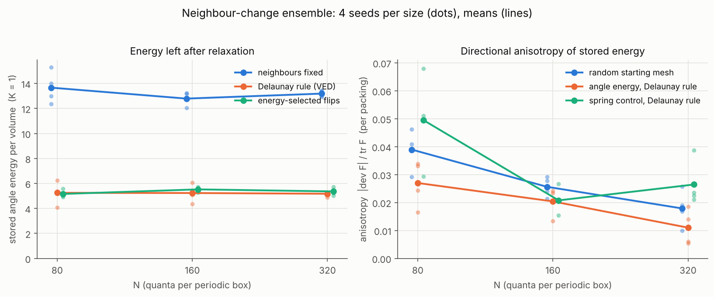

# VacuumForge: The Neighbour-Change Ensemble

## Status

```text
result type:   numerical ensemble (stage 3; 2026-11-24, derivation 062);
               TRIAL angle energy, K = 1; spring proxy as control
samples:       4 seeds x N = (80, 160, 320) (fixed cubic periodic box)
satisfies:     p10_neighbour_ensemble_061, spring_control_ensemble_057
               (first pass)
opens:         p10_large_ensemble_062 (larger N, cell shapes; GPU)
data:          vacuum_forge/src/vacuum_sector/062_neighbour_ensemble/ensemble_062.csv
verification:  vacuum_forge/src/vacuum_sector/062_neighbour_ensemble/
```



Left: angle energy per volume left after relaxation with neighbours
fixed, under VED's Delaunay rule, and under energy-selected flips. Right:
per-packing anisotropy of the stored energy for the random starting
mesh, the angle energy under the Delaunay rule, and the spring control
under the same rule. Dots are seeds; lines are means.

## Measured Results

```text
E_w per volume (mean +- std over seeds):
    N      fixed neighbours   Delaunay rule      flips              seed CV (Delaunay)
      80   13.666 +- 1.291   5.249 +- 0.887   5.160 +- 0.297   16.9%
     160   12.791 +- 0.557   5.234 +- 0.717   5.525 +- 0.196   13.7%
     320   13.189 +- 0.263   5.176 +- 0.196   5.362 +- 0.303    3.8%

Delaunay-rule endpoint, per volume (length-weighted):
    N      unavoidable        extra              n = 5 floor          n = 5 fraction
      80   2.448 +- 0.422   2.802 +- 0.506   0.0237 +- 0.0009   0.356 +- 0.019
     160   2.406 +- 0.433   2.828 +- 0.303   0.0236 +- 0.0006   0.361 +- 0.032
     320   2.523 +- 0.173   2.652 +- 0.029   0.0235 +- 0.0001   0.370 +- 0.027

Per-packing anisotropy |dev F| / tr F and fabric overlaps:
    N      random start       angle, Delaunay    spring, Delaunay   overlap A-spring  overlap A-start
      80   0.0390 +- 0.0072   0.0270 +- 0.0082   0.0495 +- 0.0158   -0.24 +- +0.47   +0.14 +- +0.56
     160   0.0256 +- 0.0036   0.0204 +- 0.0049   0.0208 +- 0.0046   +0.28 +- +0.22   +0.26 +- +0.44
     320   0.0179 +- 0.0065   0.0110 +- 0.0063   0.0265 +- 0.0083   -0.11 +- +0.31   +0.10 +- +0.33
    mean anisotropy ratio N = 80 : 320: start 2.18, angle 2.45,
    spring 1.87 (a random fluctuation would give ~2.0)

Outcomes:
    N=80   seed 1: A fixed point (8 rounds); spring fixed point (10 rounds); B 71 flips
    N=80   seed 2: A fixed point (15 rounds); spring fixed point (15 rounds); B 69 flips
    N=80   seed 3: A fixed point (14 rounds); spring fixed point (10 rounds); B 58 flips
    N=80   seed 4: A fixed point (18 rounds); spring fixed point (12 rounds); B 68 flips
    N=160  seed 1: A fixed point (21 rounds); spring fixed point (15 rounds); B 106 flips
    N=160  seed 2: A fixed point (15 rounds); spring fixed point (18 rounds); B 109 flips
    N=160  seed 3: A fixed point (14 rounds); spring fixed point (10 rounds); B 117 flips
    N=160  seed 4: A fixed point (18 rounds); spring fixed point (15 rounds); B 126 flips
    N=320  seed 1: A fixed point (15 rounds); spring fixed point (19 rounds); B 223 flips
    N=320  seed 2: A fixed point (22 rounds); spring fixed point (27 rounds); B 264 flips
    N=320  seed 3: A fixed point (16 rounds); spring fixed point (12 rounds); B 248 flips
    N=320  seed 4: A fixed point (17 rounds); spring fixed point (17 rounds); B 246 flips

Solver fallbacks (counted over every relaxation in the ensemble):
    {'angle continuation': 1, 'spring roundoff polish': 7}
    angle continuation: 061's direct relaxation failed (a sliver driven
    toward zero volume trapped the feasibility-limited Newton steps);
    re-run from the same input at mu = 1e-2, then warm-started at
    mu = 0.001. spring roundoff polish: 057's Newton stalled at the
    floating-point floor; finished with the roundoff-aware rule of 060.
```

## Reading

- **A reproducible energy density.** Under VED's Delaunay rule the
  stored angle energy per volume is 5.18–5.25 (mean per size) across
  N = 80–320, with no trend in size, and its seed-to-seed spread
  narrows as N grows (coefficient of variation 17% -> 4%). It behaves
  like an intensive quantity at these sizes. Energy-selected flips land
  in the same band (5.16–5.53). Changing neighbours releases
  59–62% of the fixed-neighbour energy at every size.
- **Far above the floor.** The residual splits roughly evenly into
  unavoidable coordination cost and uneven-sharing extra. Both are
  about two orders of magnitude above the n = 5 floor (endpoint /
  floor = 220–222); only 37% of hinges are
  five-fold. The positive floor 059 predicts is real, but these packings
  are nowhere near it.
- **No reproducible direction.** Per-packing anisotropy of the angle
  energy falls with size (0.0270 -> 0.0110, ratio 2.5 over a 4x
  increase in N; a random fluctuation gives ~2). It
  is below the random starting mesh at every size.
  The angle and spring fabrics show no consistent alignment (mean
  overlap -0.24, +0.28, -0.11 by size). The spring control is
  not less anisotropic than the angle model. At these sizes, the
  angle-gap model stores a reproducible energy density with no
  reproducible preferred direction.
- **Procedures.** All 12 of 12 Delaunay-rule runs reached a fixed
  point (a packing that is both Delaunay and relaxed), as did every
  spring-control run.
- **Limits.** Four seeds and three small sizes, one cell shape, a trial
  energy, and local endpoints. Whether the density converges, and
  whether the anisotropy keeps falling like a random fluctuation, needs
  p10_large_ensemble_062.

## Fences

```text
- TRIAL angle energy, K = 1; the spring proxy is a control, not P10.
- small sizes (N <= 320) and one cell shape; scaling claims wait for
  p10_large_ensemble_062.
- endpoints are local results: the Delaunay iteration may stop at a
  fixed point, a cycle, or the round cap; rule B is greedy (061).
- no EM coupling.
```

## Compute Environment

```text
ran on:      CPU-only cloud container (NumPy/SciPy). No GPU was
             available; attaching the theory owner's local GPU (RTX
             3080 Ti) to the cloud session was not supported.
methods:     057/060/061 code imported unchanged (periodic Delaunay,
             exact spring Hessian, exact per-tetrahedron angle Hessian
             with eigenvalue-modified Newton, incremental flips).
validation:  another Claude Code session with GPU access should rerun
             this module (ensemble_062.csv to ~1e-6) and extend it to
             N >= 1000, more seeds and non-cubic cells
             (p10_large_ensemble_062), where dense Hessians must give way
             to sparse GPU solvers.
```

## Ledger

```text
derivation:  neighbour_ensemble_062
satisfies:   p10_neighbour_ensemble_061, spring_control_ensemble_057
opens:       p10_large_ensemble_062
depends on:  neighbour_changes_061, periodic_spring_control_057
```
