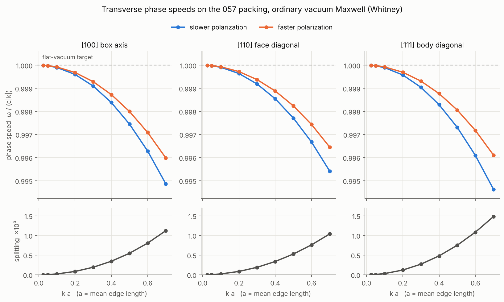

# VacuumForge: Ordinary Maxwell on the Periodic Spring Packing

## Status

```text
result type:   numerical calibration (fork (a), one seed; 2026-11-24,
               derivation 058)
conclusion:    on the exact 057 geometry, ordinary vacuum Maxwell
               (Whitney forms) passes the torus gates and recovers c
               in every tested direction as ka -> 0. The finite-ka
               departures are quadratic in ka and small: the
               mesh-and-solver baseline for later strain-coupled runs.
satisfies:     maxwell_torus_calibration_056 (gates G3a-G3c)
opens:         maxwell_packing_sweep (stage 4 proper)
geometry:      057 packing, content sha256 a8b8f23e92b4431d...
verification:  vacuum_forge/src/vacuum_sector/058_periodic_maxwell_calibration/
```



Top row: the two transverse phase speeds ω/(c|k|) against ka along a
box axis, a face diagonal, and a body diagonal; the dashed line is the
flat-vacuum target. Bottom row: their splitting (faster − slower),
×10³. Numbers below; data in
`vacuum_forge/src/vacuum_sector/058_periodic_maxwell_calibration/dispersion_058.csv`.

## Measured Results

```text
E1. GEOMETRY. 057 packing reloaded, content hash verified. V = 160,
    E = 1238, F = 2156, T = 1078, chi = 0, all tetrahedra positive;
    d1 d0 = 0 with and without a Bloch twist.

E2. HODGE CHOICE (signed circumcentric weights, assembled):
    pre-relaxation Delaunay: *1 <= 0 on 0/1238 edges, *2 <= 0 on
      0/2156 faces, although 3683/12936 elementary
      contributions are negative; 0 non-locally-Delaunay faces.
    relaxed: *1 <= 0 on 175/1238 edges (min -1.750e+01), *2 <= 0 on
      406/2156 faces (min -4.847e+01); 406/2156 faces no
      longer locally Delaunay.
    The identity sum *1 b b^T = Vol I holds exactly on both (signed).
    Diagnosis: relaxation at fixed connectivity broke the Delaunay
    property. Decision: Whitney mass matrices, kept for all paired
    comparisons.

E3. TORUS GATES (k = 0, Whitney; M1 min eig 6.229e-02, M2 min eig
    2.834e-01):
    G3a  rank d0 = 159 = V - 1; nullity d1 = 162 = V + 2; 3
         dimensions remain after removing gradients.
    G3b  uniform E fields closed, co-closed, energy = Vol I exactly;
         principal-angle cosines with the harmonic subspace = 1, 1, 1.

E4. TWISTED GATE (G3c): exactly V = 160 gradient zero modes in the full
    problem; after projection, two small positive transverse
    frequencies, far below the next mode:
    ka = 0.05 [111]: projected omega^2 = 0.002574, 0.002574, 1.982550
    ka = 0.1 [111]: projected omega^2 = 0.010292, 0.010293, 1.918653

E5. DISPERSION (fork (a); a = mean edge = 0.98559; supercell zone edge
    along [100] at ka = 0.7330). Columns: slower, faster phase speed:
    [100] box axis
      ka 0.025  0.999994  0.999995  mean 0.999994  splitting 1.30e-06
      ka 0.05   0.999975  0.999980  mean 0.999978  splitting 5.20e-06
      ka 0.1    0.999901  0.999921  mean 0.999911  splitting 2.09e-05
      ka 0.2    0.999601  0.999685  mean 0.999643  splitting 8.39e-05
      ka 0.3    0.999097  0.999288  mean 0.999193  splitting 1.91e-04
      ka 0.4    0.998384  0.998727  mean 0.998556  splitting 3.44e-04
      ka 0.5    0.997450  0.997997  mean 0.997724  splitting 5.47e-04
      ka 0.6    0.996285  0.997090  mean 0.996687  splitting 8.05e-04
      ka 0.7    0.994866  0.995986  mean 0.995426  splitting 1.12e-03
    [110] face diagonal
      ka 0.025  0.999994  0.999996  mean 0.999995  splitting 1.31e-06
      ka 0.05   0.999978  0.999983  mean 0.999980  splitting 5.25e-06
      ka 0.1    0.999910  0.999931  mean 0.999921  splitting 2.10e-05
      ka 0.2    0.999640  0.999724  mean 0.999682  splitting 8.41e-05
      ka 0.3    0.999188  0.999377  mean 0.999282  splitting 1.89e-04
      ka 0.4    0.998547  0.998884  mean 0.998716  splitting 3.37e-04
      ka 0.5    0.997712  0.998240  mean 0.997976  splitting 5.27e-04
      ka 0.6    0.996673  0.997434  mean 0.997054  splitting 7.61e-04
      ka 0.7    0.995417  0.996454  mean 0.995936  splitting 1.04e-03
    [111] body diagonal
      ka 0.025  0.999993  0.999995  mean 0.999994  splitting 1.87e-06
      ka 0.05   0.999974  0.999981  mean 0.999977  splitting 7.47e-06
      ka 0.1    0.999894  0.999924  mean 0.999909  splitting 2.99e-05
      ka 0.2    0.999576  0.999696  mean 0.999636  splitting 1.20e-04
      ka 0.3    0.999043  0.999313  mean 0.999178  splitting 2.69e-04
      ka 0.4    0.998290  0.998770  mean 0.998530  splitting 4.80e-04
      ka 0.5    0.997310  0.998061  mean 0.997686  splitting 7.51e-04
      ka 0.6    0.996092  0.997177  mean 0.996635  splitting 1.08e-03
      ka 0.7    0.994623  0.996105  mean 0.995364  splitting 1.48e-03
    Quadratic fits:
    [100] box axis         1 - v_mean = 0.00924 (ka)^2   splitting ~ 0.00225 (ka)^2
    [110] face diagonal    1 - v_mean = 0.00822 (ka)^2   splitting ~ 0.00211 (ka)^2
    [111] body diagonal    1 - v_mean = 0.00938 (ka)^2   splitting ~ 0.00302 (ka)^2
```

## Reading

- Both polarizations approach c in every tested direction as ka -> 0.
  The packing keeps its stored spring strain (057) while ordinary
  long-wavelength light propagation is recovered on the same geometry.
- At finite ka the speeds fall below c quadratically, with a small
  polarization splitting. Both numbers are this mesh and solver's own
  apparent optical effect: the baseline a fork-(b) run on the same
  packing must exceed.
- Near the supercell zone edge the next pair of modes is the same
  transverse branch folded back from k − G. It is a consequence of the
  periodic repetition, not a mesh-scale mode, and it limits how far in
  ka one box can be scanned.
- The quadratic coefficient varies little between the three
  directions at this size. Whether that spread is a property of the
  packing, of the cubic supercell, or of finite size needs the
  ensemble (maxwell_packing_sweep).

## Compute Environment

```text
ran on:      CPU-only cloud container (NumPy/SciPy). No GPU was
             available; attaching the theory owner's local GPU (RTX
             3080 Ti) to the cloud session was not supported.
methods:     chosen for CPU efficiency at this size. Whitney mass
             matrices assembled per tetrahedron; Bloch-twisted
             operators built once per k; the gradient subspace removed
             by an explicit null-space projection so only the lowest
             few transverse modes are computed (dense complex
             Hermitian eigensolves, ~1078 unknowns, ~1.5 s per k). The
             torus gates use exact ranks and principal angles.
validation:  another Claude Code session with GPU access should rerun
             this module on the same 057 packing (hash-verified) and
             confirm the gates and the phase speeds to ~1e-8. A GPU is
             what makes the next step practical: larger packings
             (smaller ka at the zone edge), many seeds and cell shapes
             (maxwell_packing_sweep), with sparse Whitney operators and
             a GPU shift-invert or LOBPCG eigensolver replacing the
             dense solves.
```

## Fences

```text
- fork (a) only: ordinary vacuum coefficients, no strain coupling.
- one seed, one size, one cubic box: the packing repeated
  periodically; ka is limited by the supercell zone.
- Whitney discretization, chosen by the E2 rule; keep it fixed for
  paired comparisons.
- no claim that spatial quanta produce EM; no channel (06 quarantine).
```

## Ledger

```text
derivation:  periodic_maxwell_calibration_058
satisfies:   maxwell_torus_calibration_056
opens:       maxwell_packing_sweep
depends on:  periodic_spring_control_057, maxwell_regular_mesh_056
```
